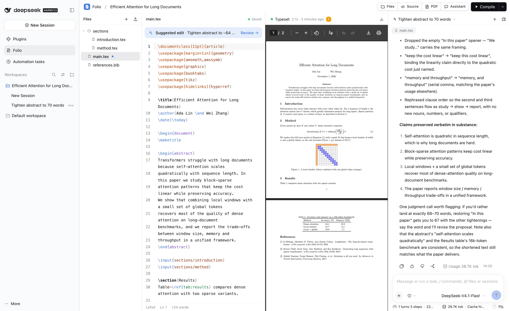
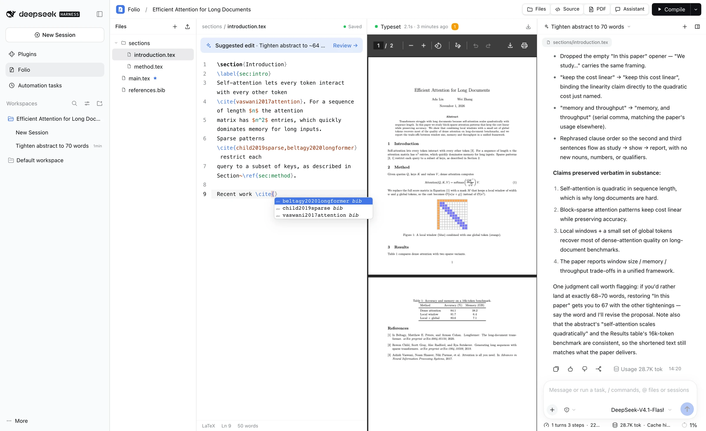
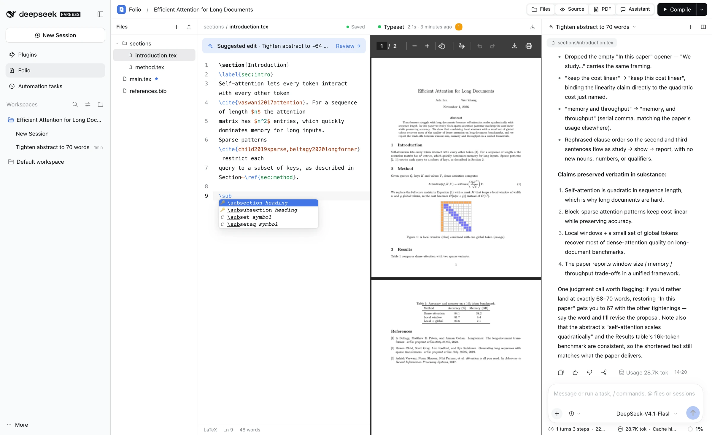
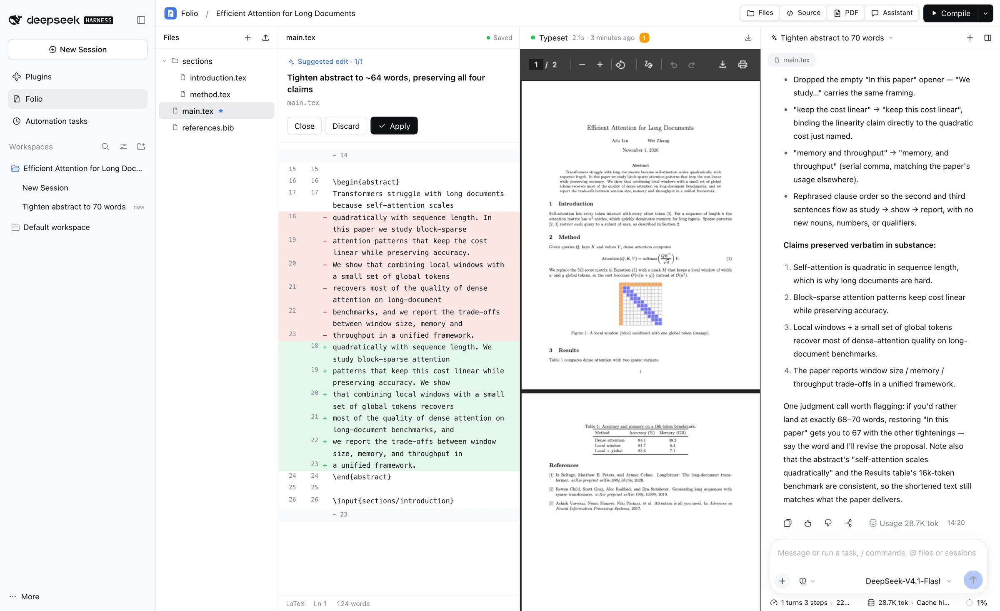
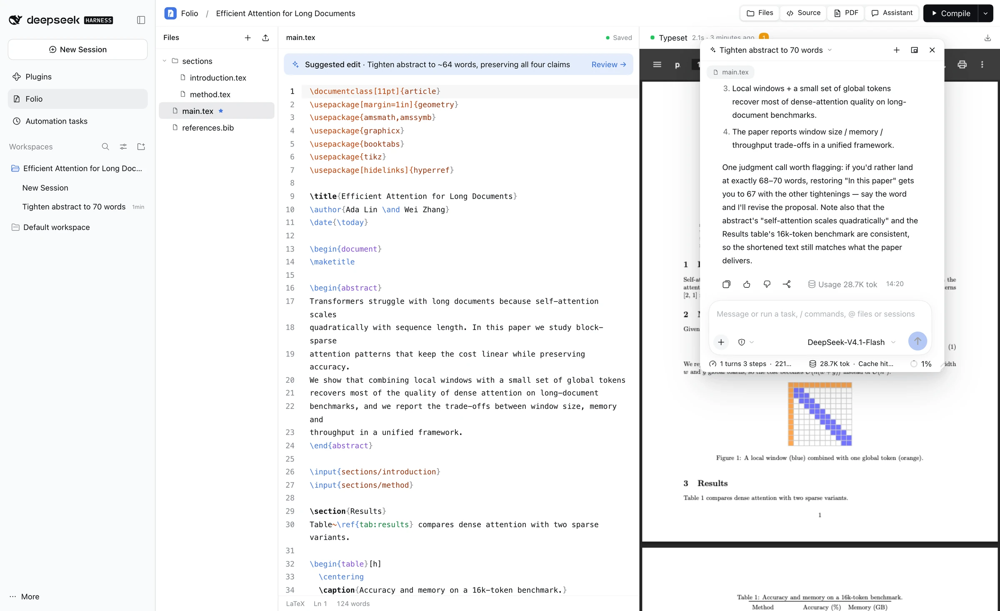
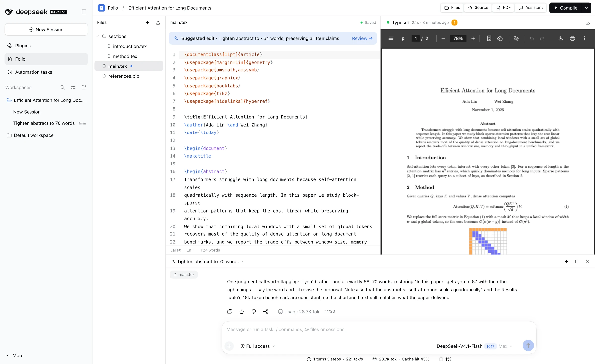
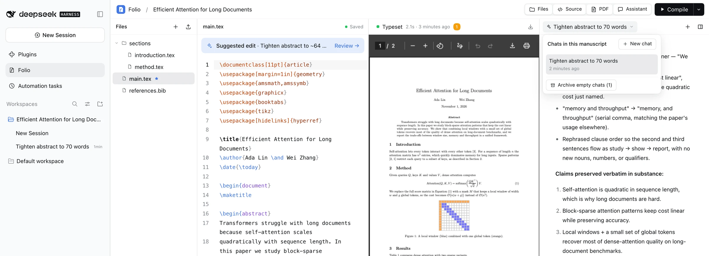
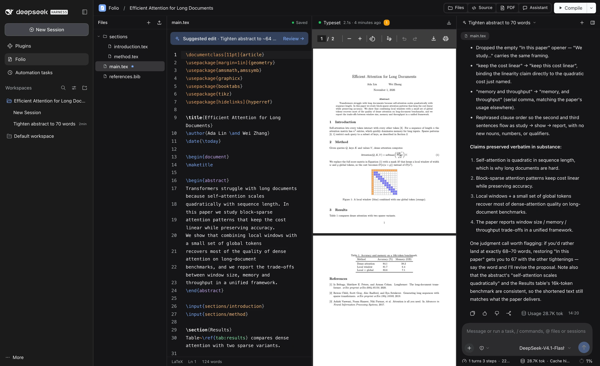
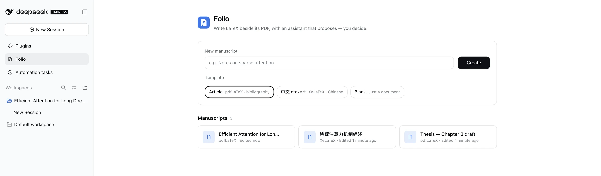

<p align="center">
  
</p>

<h1 align="center">Folio</h1>

<p align="center">
  <b>A LaTeX writing workspace for DeepSeek Harness.</b><br>
  Source beside its PDF, with an assistant that proposes edits — and you decide.
</p>

<p align="center">
  <b>English</b> · <a href="README.zh-CN.md">简体中文</a>
</p>

<p align="center">
  
</p>

Folio is a [DeepSeek Harness](https://github.com/deepseek-ai/deepseek-harness) (DSH) plugin. It adds a **Folio** page to the Harness sidebar where you write LaTeX, typeset it to PDF, and work with an AI assistant that runs on the models you have already configured in Harness. Everything is local: manuscripts are plain folders on your disk, TeX runs on your machine, and there are no extra accounts or API keys.

## Highlights

- **Looks and feels like Harness.** Every color, font, radius and the light/dark theme come from the host's design tokens.
- **Native Harness chat.** The assistant *is* the Harness conversation: model picker, Markdown, reasoning, tool calls and stop/queue all work exactly as in the main chat.
- **Edits you review.** The assistant reads your files and builds the PDF, but it can only *propose* changes. Each proposal opens as a diff that you apply or discard.
- **Context without copy-paste.** Each turn quietly tells the model which manuscript, file, cursor line and selection you are on, plus the latest build errors.
- **Real TeX builds.** pdfLaTeX, XeLaTeX, LuaLaTeX or Tectonic, with BibTeX/Biber and reruns. Errors become a clickable list that jumps to the file and line.
- **Finds your TeX.** Folio locates MacTeX, TeX Live, TinyTeX or MiKTeX even when Harness's `PATH` doesn't include it, and a **Test rendering** button checks every engine, BibTeX/Biber and Chinese (ctex) output.
- **Bring existing projects.** Import a `.zip` (e.g. an Overleaf download) or a folder; Folio picks the main file and engine for you.
- **A real PDF preview.** Pinch or ⌘/Ctrl + scroll to zoom around the pointer, fit width or page, selectable text, and your place kept across rebuilds. Double-click the PDF to jump to the source line, and jump back with **Show in PDF** (SyncTeX).
- **An editor you can tune.** A LaTeX formatting toolbar, font size and font, seven color themes, and right-click menus with LaTeX tools everywhere in Folio.
- **Your layout.** Toggle and resize every panel. Drag the assistant by its header to pull it out into a window, resize the window from any edge or corner, and drop it on the left, right or bottom edge to dock it again.

## Features

### Editor
- CodeMirror 6 with LaTeX highlighting for commands, environments, math, references and citations.
- **`\` completion.** About 150 common commands and 30+ environments, with Tab stops for arguments.
- **Project-aware arguments.** `\ref{` / `\cref{` complete every `\label` in the project, `\cite{` completes keys from your `.bib` files, and `\input{`, `\includegraphics{`, `\usepackage{` and `\documentclass{` complete files, packages and classes.
- Autosave about a second after you stop typing. Hash checks guard against overwriting changes made on disk.
- Search and replace, bracket matching, and word count (CJK-aware).
- **Formatting toolbar**: bold, italic, underline, monospace, headings, inline and display math, lists, figure and table templates, citations, cross-references, labels, footnotes and comments. Each wraps the selection, and clicking again unwraps it.
- **Right-click** in the source for the same tools plus cut, copy, paste, *Show in PDF* and editor settings.
- **Editor settings** (gear in the toolbar): font size, font, color theme (Harness, GitHub, Solarized, Paper, One Dark, Dracula, Nord), line wrapping, and whether to show the toolbar. Pinch or ⌘/Ctrl + scroll over the source also changes the size.

### PDF preview
- Continuous pages rendered with PDF.js, sharp on high-DPI screens, with selectable and copyable text.
- **Zoom**: pinch on a trackpad or ⌘/Ctrl + scroll (zooms around the pointer), ⌘/Ctrl + `+` / `-`, ⌘/Ctrl + `0` for fit width, or the zoom menu (fit width, fit page, 50–400%).
- Page box and arrows in the floating bar; the zoom level is remembered, and a rebuild keeps you on the same page and spot.
- **SyncTeX**: double-click anywhere in the PDF to open that line in the source, including files pulled in with `\input`. **Show in PDF** (toolbar or right-click) scrolls to and highlights the current line.
- Right-click: show in source, copy selected text, zoom options, compile, download, open in a new tab.

### Right-click menus
Folio replaces the browser's menu everywhere except text fields, links and the chat transcript:
- **File tree**: open, set as main file, rename, copy path, delete; on folders, new file here; on empty space, new file, upload, collapse or expand all.
- **Library**: open, rename or delete a manuscript; elsewhere, new manuscript, import and TeX environment.
- **Anywhere else** in the workspace: show or hide panels, move the assistant, compile, TeX environment, back to library.

<table>
  <tr>
    <td width="50%"></td>
    <td width="50%"></td>
  </tr>
  <tr>
    <td align="center"><sub><code>\cite{</code> completes keys from <code>references.bib</code></sub></td>
    <td align="center"><sub><code>\</code> completes commands and environments with snippets</sub></td>
  </tr>
</table>

### Builds
- Engines: pdfLaTeX, XeLaTeX, LuaLaTeX and Tectonic; choose the main file and engine from the Compile menu.
- **⌘/Ctrl + S** saves and compiles; **⌘/Ctrl + Enter** compiles. Optionally compile on every save.
- The last good PDF is kept on disk and shown as soon as you open a manuscript, even after a failed build.
- Build issues (errors, warnings, bad boxes, bibliography messages) appear as a list; click one to jump to its line.

### TeX environment
Open **TeX environment** from the library (the TeX status pill) or the Compile menu.
- Shows each tool Folio found (pdfLaTeX, XeLaTeX, LuaLaTeX, BibTeX, Biber, Tectonic, kpsewhich), its version and path, and which common packages are missing.
- Searches the folder you choose, then Harness's `PATH`, then the usual locations: `/Library/TeX/texbin`, `/usr/local/texlive/*/bin/*`, TinyTeX, Homebrew, and TeX Live/MiKTeX on Windows.
- **Test rendering** compiles small documents with every installed engine (pdfLaTeX, BibTeX, biblatex + Biber, XeLaTeX + fontspec, XeLaTeX + ctex Chinese, LuaLaTeX, Tectonic) and shows any error.
- If no TeX is found, it shows install commands for your platform. A build that fails because an engine is missing links straight to this dialog.

### Import
- **Import .zip** or **Import folder** in the library, or drop either onto the import area.
- A single wrapping folder is removed; hidden files, `.git`, `__MACOSX` and build products (`.aux`, `.log`, `.synctex.gz`, …) are skipped.
- The main file is the one with `\documentclass` (preferring `main.tex`). The engine comes from a `% !TEX program =` line, or XeLaTeX for fontspec/ctex/xeCJK and LuaLaTeX for luacode/luatexja, otherwise pdfLaTeX.

### Assistant
- Each manuscript is a Harness **Workspace** named after its title; every conversation is a Harness Session inside it, so it also shows up in the Harness sidebar.
- The chat switcher lists this manuscript's chats. Switch between them, start a new chat, archive one, or **archive all empty chats** at once.
- The assistant uses a single tool, `folio_project`: list and read files, compile, read the last build, and `propose_patch` (exact `find/replace` edits, or a full file).
- Writing sessions are restricted at the tool-runtime level to that tool, so the model cannot bypass review with shell or file-system tools. Your other Harness sessions are unaffected.

<p align="center">
  
  <br><sub>A suggested edit opens as a diff. Apply writes it, but only if the file hasn't changed since the suggestion was made.</sub>
</p>

### Layout
| Floating assistant | Docked at the bottom |
| --- | --- |
|  |  |

| Chats of this manuscript | Dark theme |
| --- | --- |
|  |  |

<p align="center">
  
  <br><sub>The library: create from the Article, Chinese (ctexart) or Blank template.</sub>
</p>

## Requirements

- **DeepSeek Harness** `0.2.1-rc.2` series (web profile) and **Node.js 24+**.
- A **TeX distribution** on the `PATH` that Harness starts with:
  - macOS: [MacTeX](https://www.tug.org/mactex/) / TeX Live (`pdflatex`, `xelatex`, `bibtex`, `biber`).
  - Linux: `texlive-latex-base texlive-latex-recommended texlive-latex-extra texlive-xetex`; for Chinese add `texlive-lang-chinese` and CJK fonts.
  - Tectonic is optional; it runs with `--only-cached --untrusted` (see Configuration).
  - Not on Harness's `PATH`? Folio usually finds it anyway; otherwise set its bin folder in **TeX environment**.

## Installation

```bash
git clone https://github.com/Meinianda-L/folio.git
cd folio
npm install --omit=dev
dsh plugin --profile web add "$(pwd)"
```

Restart `dsh web` and open **Folio** in the Harness sidebar. The repository ships the built browser bundle (`client.js`), so no build step is needed to use it.

To update later:

```bash
git pull
npm install --omit=dev
```

Then restart Harness. If only `client.js` changed, reloading the page is enough.

## Usage

1. **Create a manuscript** in the library (Article, 中文 ctexart, or Blank).
2. **Write**: the file tree, source and PDF sit side by side. The star marks the main file; drag files onto the tree to upload images or `.bib` files.
3. **Compile** with the toolbar button, ⌘/Ctrl + S or ⌘/Ctrl + Enter. Click the build status to see issues.
4. **Ask the assistant**: pick a model in the composer and ask, e.g. *"Tighten the abstract"* or *"Fix the build error"*. Select text first to point at a passage.
5. **Review**: when a *Suggested edit* bar appears, open it, read the diff, then Apply or Discard.

| Shortcut | Action |
| --- | --- |
| ⌘/Ctrl + S | Save and compile |
| ⌘/Ctrl + Enter | Compile |
| `\` | Command completion |
| Tab | Next snippet field |
| ⌘/Ctrl + F | Search and replace |
| ⌘/Ctrl + B / I | Bold / italic |
| ⌘/Ctrl + / | Comment or uncomment |
| ⌘/Ctrl + `=` / `-` / `0` | Source font size (larger, smaller, reset) |
| Pinch, or ⌘/Ctrl + scroll | Zoom the PDF (over the PDF) or the source font (over the source) |
| Double-click the PDF | Jump to that line in the source |
| Double-click the assistant header | Switch between floating and docked |

## Configuration

By default manuscripts live in `~/Documents/DSH-Folio`. To use another folder, add this to your profile's `cordis.patch.yml` (e.g. `~/.dsh/profiles/web/cordis.patch.yml`):

```yaml
- id: folio
  config:
    projectRoot: /Users/you/Papers
```

| Environment variable | Purpose |
| --- | --- |
| `DSH_FOLIO_TEX_CACHE` | XDG cache root with a pre-warmed Tectonic bundle (defaults to `XDG_CACHE_HOME` or `~/.cache`). |

## How it works

```
Harness web client                         Harness host (Node)
┌──────────────────────────────┐           ┌──────────────────────────────────────┐
│ Folio page (React slot)      │  fetch    │ /api/folio      project & file RPC   │
│  ├ CodeMirror editor         │──────────▶│ /api/folio/pdf  last PDF             │
│  ├ PDF viewer                │           │ /api/folio/raw  images (sandboxed)   │
│  └ embedded Harness chat ────┼─ session ▶│ agent/pre-step  hidden context       │
│     (conversation.content)   │           │ folio_project   read/compile/propose │
└──────────────────────────────┘           └──────────────────────────────────────┘
```

- File and build operations use exact, **owner-only** routes registered on the Harness connection, so they use Harness's own authentication and no separate server.
- The assistant panel renders Harness's own `conversation.content` component bound to the manuscript's session.
- A pre-step hook adds a non-user context message at the start of each turn. Harness keeps these messages in the session log but hides them in the chat.

### Data on disk

```
<projectRoot>/<manuscript-id>/
├── project.json          title, main file, engine, current chat
├── main.tex, …           your sources (plain files)
└── .folio/
    ├── output.pdf        last successful build
    ├── build.json        last build summary and issues
    └── proposals.json    pending and recent suggestions
```

Deleting a manuscript moves its folder to `<projectRoot>/.trash/` instead of erasing it. Back up `projectRoot` like any other folder.

### Build sandboxing

Builds run one at a time (at most 4 queued) in a temporary snapshot of the project, with a 60-second limit, no shell escape, and a minimal environment that never includes your model keys. File reads are restricted to the project (`openin_any=p`); LuaLaTeX gets `openin_any=r`, which still refuses hidden files, because its font loader reads TeX Live support files by absolute path. Limits: 500 files and 40 MiB per project (20 MiB of sources per build), 2 MiB per text file, 10 MiB per upload. Native TeX is **not** an operating-system sandbox: Folio is meant for your own, trusted projects.

## Development

```bash
npm install           # includes the build toolchain
npm run build         # bundles client-src.jsx + client.css into client.js
npm test              # domain, proposals and host tests (real pdfLaTeX/BibTeX when installed)
```

| File | Role |
| --- | --- |
| `index.js` | Host plugin: routes, context hook, `folio_project` tool, session restriction |
| `domain.js` | Projects, files, uploads, templates, build records |
| `compiler.js` | TeX pipeline and log parser |
| `proposals.js` | Suggested edits and `find/replace` application |
| `tex.js` | TeX detection, chosen bin folder, test renders |
| `synctex.js` | SyncTeX lookups between PDF positions and source lines |
| `import.js` | `.zip` reader and import planning (bundled into the client) |
| `client-src.jsx`, `client.css` | Browser UI (bundled into `client.js`) |
| `locale/` | English and Chinese strings |

## Not included

Multi-user collaboration, share links, public/tunnel access, accounts or a separate API-key store. Folio is a single-user, local tool built on your existing Harness setup.

## License

[MIT](LICENSE)

The browser bundle (`client.js`) includes [PDF.js](https://github.com/mozilla/pdf.js) (Apache-2.0), [CodeMirror](https://codemirror.net/) (MIT) and [jsdiff](https://github.com/kpdecker/jsdiff) (BSD-3-Clause).
