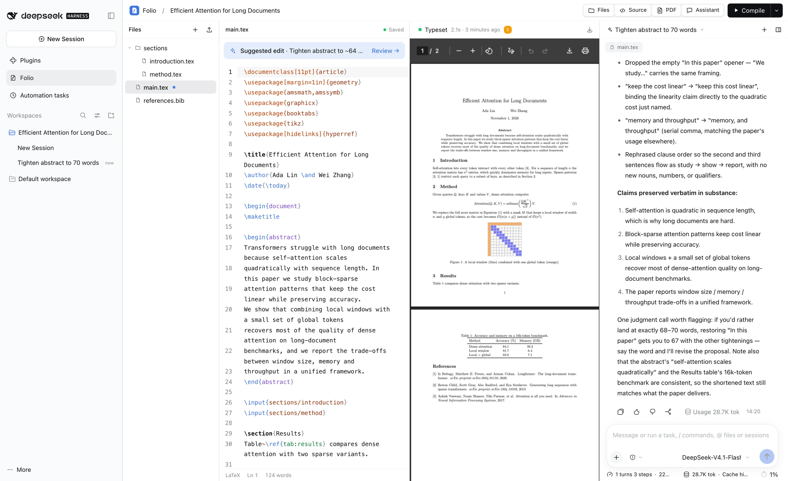
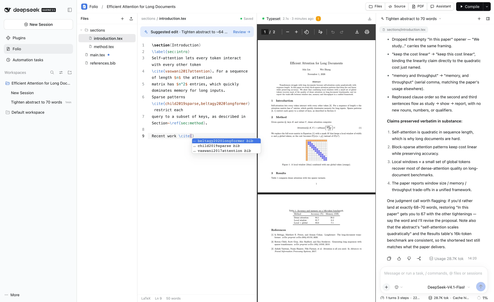
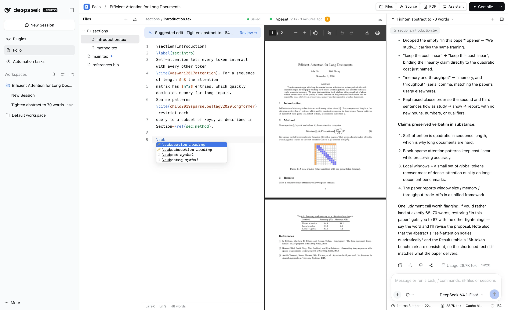
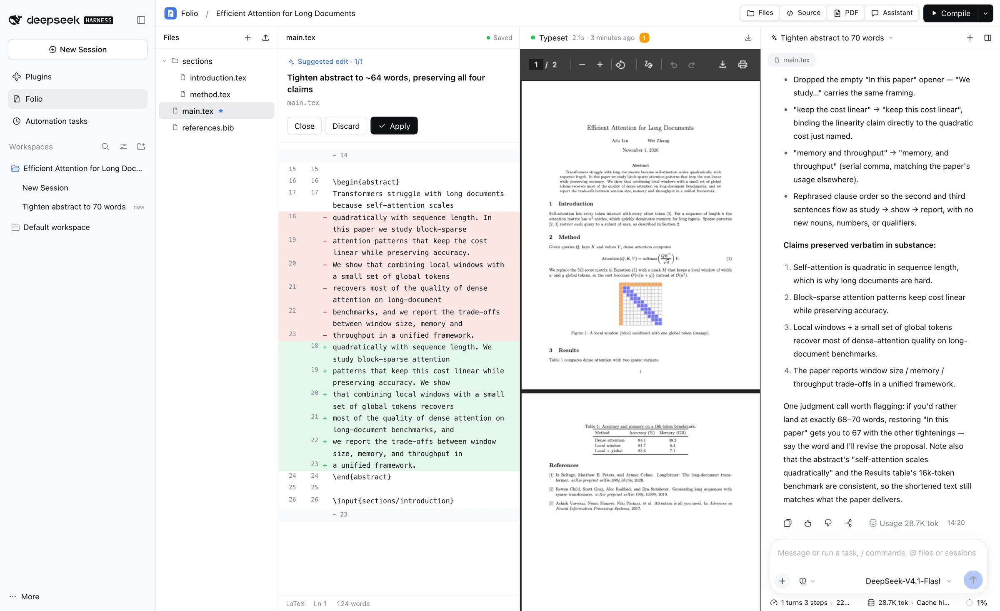
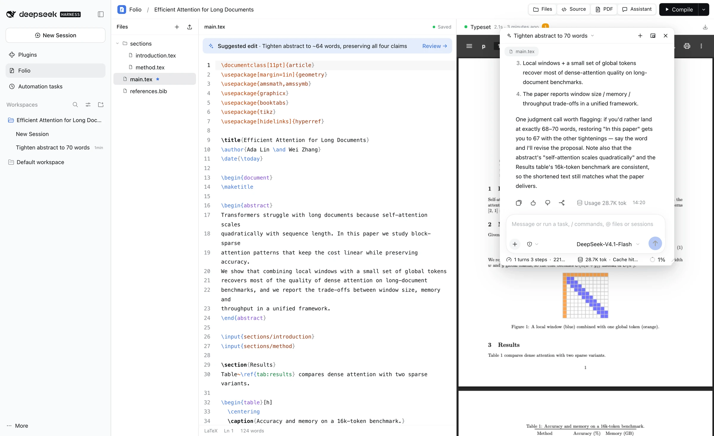
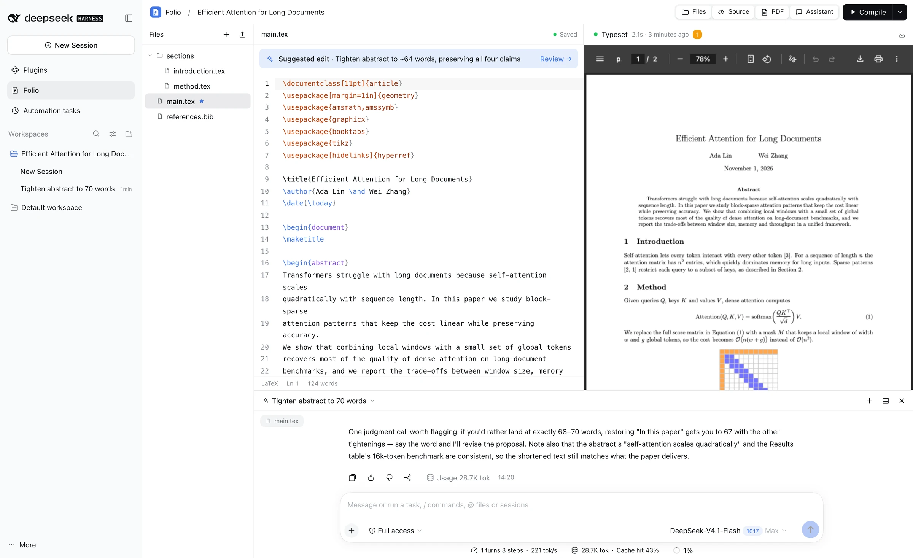
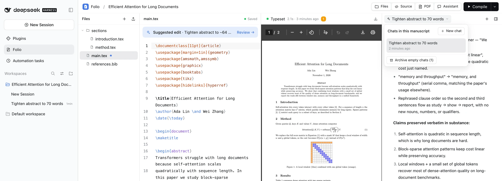
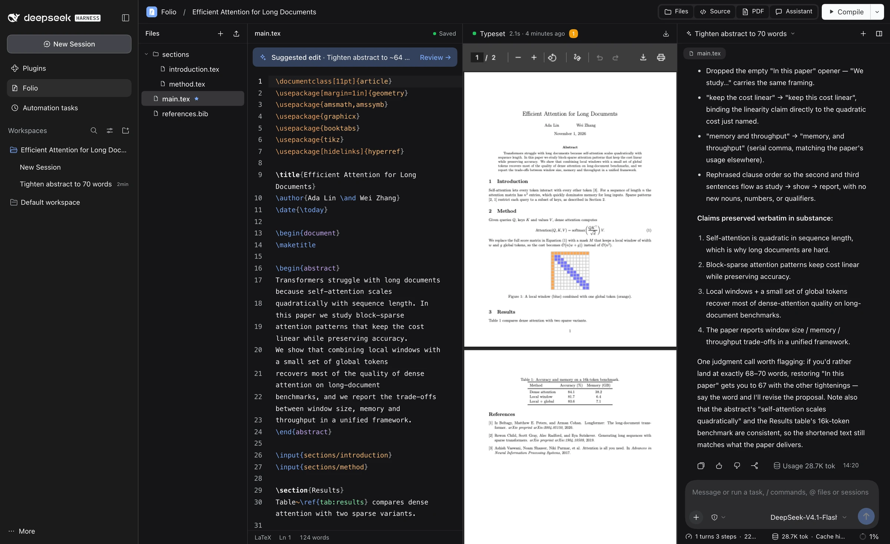
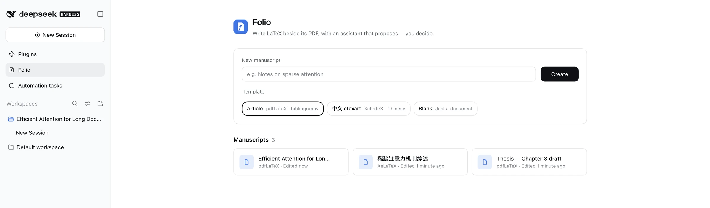

<p align="center">
  
</p>

<h1 align="center">Folio</h1>

<p align="center">
  <b>DeepSeek Harness 里的 LaTeX 写作工作区。</b><br>
  源码与 PDF 并排，助手只提修改建议，由你决定。
</p>

<p align="center">
  <a href="README.md">English</a> · <b>简体中文</b>
</p>

<p align="center">
  
</p>

Folio 是一个 [DeepSeek Harness](https://github.com/deepseek-ai/deepseek-harness)（DSH）插件。它在 Harness 侧栏加入 **Folio 写作** 页面：在这里写 LaTeX、编译成 PDF，并与 AI 助手协作。助手使用你在 Harness 里已配置好的模型。一切都在本机完成：文稿就是磁盘上的普通文件夹，TeX 在本机运行，不需要额外账号或 API Key。

## 亮点

- **与 Harness 浑然一体**：颜色、字体、圆角和明暗主题全部取自宿主的设计令牌。
- **原生 Harness 对话**：助手就是 Harness 自己的对话组件。模型选择、Markdown、思考过程、工具调用、停止与排队，和主聊天界面完全一致。
- **修改由你审阅**：助手能读取文件、编译 PDF，但只能*提出*修改。每条建议以差异视图打开，由你应用或舍弃。
- **上下文无需复制粘贴**：每一轮对话都会悄悄告诉模型当前文稿、文件、光标行、选中文本和最近的编译错误。
- **真实 TeX 编译**：pdfLaTeX、XeLaTeX、LuaLaTeX 或 Tectonic，自动运行 BibTeX/Biber 并重编译；错误整理成列表，点击跳到对应文件和行。
- **自动找到 TeX**：即使 Harness 的 `PATH` 里没有，Folio 也能找到 MacTeX、TeX Live、TinyTeX 或 MiKTeX；“测试渲染”一键检查各引擎、BibTeX/Biber 和中文（ctex）输出。
- **导入已有项目**：导入 `.zip`（例如从 Overleaf 下载的）或文件夹，自动识别主文件和编译引擎。
- **布局随你**：每个面板都能开关、拖动尺寸。按住助手标题栏即可拖出成浮窗，浮窗的任意边和角都能拉伸；拖到左、右或底部边缘松手即重新停靠。

## 功能

### 编辑器
- CodeMirror 6，LaTeX 语法高亮：命令、环境、数学、引用分色显示。
- **`\` 自动补全**：约 150 个常用命令和 30 多个环境，参数位置可按 Tab 依次跳转。
- **按项目补全参数**：`\ref{` / `\cref{` 补全全项目的 `\label`；`\cite{` 补全 `.bib` 中的条目；`\input{`、`\includegraphics{`、`\usepackage{`、`\documentclass{` 补全文件、宏包和文档类。
- 停止输入约 1 秒后自动保存；用文件哈希防止覆盖磁盘上的改动。
- 搜索替换、括号匹配、字数统计（支持中文）。

<table>
  <tr>
    <td width="50%"></td>
    <td width="50%"></td>
  </tr>
  <tr>
    <td align="center"><sub><code>\cite{</code> 补全 <code>references.bib</code> 中的条目</sub></td>
    <td align="center"><sub>输入 <code>\</code> 补全命令和环境，带占位符</sub></td>
  </tr>
</table>

### 编译
- 引擎：pdfLaTeX、XeLaTeX、LuaLaTeX、Tectonic；在“编译”菜单中选择主文件和引擎。
- **⌘/Ctrl + S** 保存并编译，**⌘/Ctrl + Enter** 编译；可开启“保存时自动编译”。
- 上一次成功的 PDF 保存在磁盘上，打开文稿即可看到；编译失败也不会丢。
- 编译问题（错误、警告、排版溢出、参考文献提示）整理成列表，点击即跳到对应行。

### TeX 环境
在文稿库右上角的 TeX 状态标签，或“编译”菜单里打开 **TeX 环境**。
- 列出找到的每个工具（pdfLaTeX、XeLaTeX、LuaLaTeX、BibTeX、Biber、Tectonic、kpsewhich）及其版本和路径，并提示缺少哪些常用宏包。
- 查找顺序：你指定的文件夹、Harness 的 `PATH`、常见安装位置（`/Library/TeX/texbin`、`/usr/local/texlive/*/bin/*`、TinyTeX、Homebrew，以及 Windows 上的 TeX Live / MiKTeX）。
- **测试渲染**：用每个已安装的引擎编译小文档（pdfLaTeX、BibTeX、biblatex + Biber、XeLaTeX + fontspec、XeLaTeX + ctex 中文、LuaLaTeX、Tectonic），并显示出错信息。
- 没找到 TeX 时会给出对应平台的安装命令；因缺少引擎而编译失败时，点错误即可打开这里。

### 导入
- 在文稿库点 **导入 .zip** 或 **导入文件夹**，也可以直接拖到导入区域。
- 自动去掉外层的单个文件夹；跳过隐藏文件、`.git`、`__MACOSX` 和编译产物（`.aux`、`.log`、`.synctex.gz` 等）。
- 主文件取含 `\documentclass` 的文件（优先 `main.tex`）；引擎按 `% !TEX program =` 注释判断，否则用到 fontspec/ctex/xeCJK 选 XeLaTeX，用到 luacode/luatexja 选 LuaLaTeX，其余用 pdfLaTeX。

### 助手
- 每份文稿对应一个以标题命名的 Harness **工作区**，每次对话都是其中的一个 Harness 会话，在 Harness 侧栏同样可见。
- 对话切换器列出本文稿的所有对话：可以切换、新建、归档，或一键**归档空对话**。
- 助手只使用一个工具 `folio_project`：列出和读取文件、编译、读取上次编译结果，以及 `propose_patch`（精确的 `find/replace` 替换，或整文件）。
- 写作会话在工具运行层被限制为只能使用该工具，模型无法借助 shell 或文件工具绕过审阅流程；其他 Harness 会话不受影响。

<p align="center">
  
  <br><sub>修改建议以差异视图打开。点“应用”才会写入，而且仅当文件在建议生成后没有被改动时才会成功。</sub>
</p>

### 布局
| 浮动助手 | 停靠底部 |
| --- | --- |
|  |  |

| 本文稿的对话 | 深色主题 |
| --- | --- |
|  |  |

<p align="center">
  
  <br><sub>文稿库：可用英文论文、中文 ctexart 或空白模板新建。</sub>
</p>

## 环境要求

- **DeepSeek Harness** `0.2.1-rc.2` 系列（web profile）与 **Node.js 24+**。
- 启动 Harness 时 `PATH` 中有 **TeX 发行版**：
  - macOS：[MacTeX](https://www.tug.org/mactex/) / TeX Live（`pdflatex`、`xelatex`、`bibtex`、`biber`）。
  - Linux：`texlive-latex-base texlive-latex-recommended texlive-latex-extra texlive-xetex`；中文再加 `texlive-lang-chinese` 和中文字体。
  - Tectonic 可选，以 `--only-cached --untrusted` 运行（见“配置”）。
  - Harness 的 `PATH` 里没有 TeX？Folio 通常也能自动找到；找不到时在 **TeX 环境** 里填写它的 bin 文件夹。

## 安装

```bash
git clone https://github.com/Meinianda-L/folio.git
cd folio
npm install --omit=dev
dsh plugin --profile web add "$(pwd)"
```

重启 `dsh web`，在 Harness 侧栏打开 **Folio 写作**。仓库已附带构建好的浏览器端文件 `client.js`，直接使用无需构建。

之后更新：

```bash
git pull
npm install --omit=dev
```

然后重启 Harness。若只更新了 `client.js`，刷新页面即可。

## 使用

1. 在文稿库**新建文稿**（英文论文、中文 ctexart 或空白）。
2. **写作**：文件树、源码与 PDF 并排；★ 表示主文件；把图片或 `.bib` 拖到文件树即可上传。
3. **编译**：点工具栏按钮，或按 ⌘/Ctrl + S、⌘/Ctrl + Enter；点编译状态查看问题列表。
4. **问助手**：在输入框选择模型，例如“精简摘要”或“修复编译错误”；先选中文本可以指定要处理的段落。
5. **审阅**：出现“修改建议”提示条时点开查看差异，再选择应用或舍弃。

| 快捷键 | 作用 |
| --- | --- |
| ⌘/Ctrl + S | 保存并编译 |
| ⌘/Ctrl + Enter | 编译 |
| `\` | 命令补全 |
| Tab | 跳到下一个占位符 |
| ⌘/Ctrl + F | 搜索替换 |
| 双击助手标题栏 | 在浮窗与停靠之间切换 |

## 配置

文稿默认保存在 `~/Documents/DSH-Folio`。如需更换目录，在 profile 的 `cordis.patch.yml`（例如 `~/.dsh/profiles/web/cordis.patch.yml`）中加入：

```yaml
- id: folio
  config:
    projectRoot: /Users/you/Papers
```

| 环境变量 | 作用 |
| --- | --- |
| `DSH_FOLIO_TEX_CACHE` | 预热好的 Tectonic 缓存所在的 XDG 缓存根目录（默认 `XDG_CACHE_HOME` 或 `~/.cache`）。 |

## 工作原理

```
Harness 网页端                              Harness 宿主（Node）
┌──────────────────────────────┐           ┌──────────────────────────────────────┐
│ Folio 页面（React slot）      │  fetch    │ /api/folio      项目与文件 RPC        │
│  ├ CodeMirror 编辑器          │──────────▶│ /api/folio/pdf  最近一次 PDF          │
│  ├ PDF 预览                   │           │ /api/folio/raw  图片（沙盒响应头）     │
│  └ 内嵌 Harness 对话 ─────────┼─ 会话 ───▶│ agent/pre-step  隐藏的上下文          │
│     （conversation.content）  │           │ folio_project   读取/编译/提出修改     │
└──────────────────────────────┘           └──────────────────────────────────────┘
```

- 文件与编译操作走 Harness 连接上注册的**仅限所有者**的精确路由，复用 Harness 自身的鉴权，不另起服务器。
- 助手面板直接渲染 Harness 自己的 `conversation.content` 组件，并绑定到该文稿的会话。
- pre-step 钩子在每轮开始时加入一条非用户来源的上下文消息。Harness 会把它记入会话日志，但不在聊天里显示。

### 磁盘上的数据

```
<projectRoot>/<文稿 ID>/
├── project.json          标题、主文件、引擎、当前对话
├── main.tex, …           你的源文件（普通文件）
└── .folio/
    ├── output.pdf        最近一次成功的编译结果
    ├── build.json        最近一次编译的摘要与问题
    └── proposals.json    待审阅与最近的修改建议
```

删除文稿时，文件夹会移到 `<projectRoot>/.trash/`，不会直接抹掉。像备份普通文件夹一样备份 `projectRoot` 即可。

### 编译隔离

编译全局串行（最多 4 个排队），在项目的临时快照中进行，60 秒超时，禁用 shell escape，使用最小化环境变量，绝不传入模型密钥。文件读取限制在项目内（`openin_any=p`）；LuaLaTeX 的字体加载器需要按绝对路径读取 TeX Live 自带文件，因此改用 `openin_any=r`，仍然禁止读取隐藏文件。限制：每个项目 500 个文件、40 MiB（每次编译源文件 20 MiB），单个文本文件 2 MiB，单次上传 10 MiB。原生 TeX **不是**操作系统级沙箱，Folio 面向你自己的可信项目。

## 开发

```bash
npm install           # 包含构建工具链
npm run build         # 把 client-src.jsx 与 client.css 打包成 client.js
npm test              # 领域、建议与宿主测试（本机装有 pdfLaTeX/BibTeX 时会真实编译）
```

| 文件 | 作用 |
| --- | --- |
| `index.js` | 宿主插件：路由、上下文钩子、`folio_project` 工具、会话限制 |
| `domain.js` | 项目、文件、上传、模板、编译记录 |
| `compiler.js` | TeX 编译流程与日志解析 |
| `proposals.js` | 修改建议与 `find/replace` 应用 |
| `tex.js` | TeX 检测、指定 bin 文件夹、测试渲染 |
| `import.js` | `.zip` 读取与导入规划（打包进浏览器端） |
| `client-src.jsx`、`client.css` | 浏览器端界面（打包为 `client.js`） |
| `locale/` | 中英文文案 |

## 不包含

多人协作、分享链接、公网或隧道访问、账号体系或独立的 API Key 存储。Folio 是基于你现有 Harness 环境的单用户本地工具。

## 许可证

[MIT](LICENSE)
